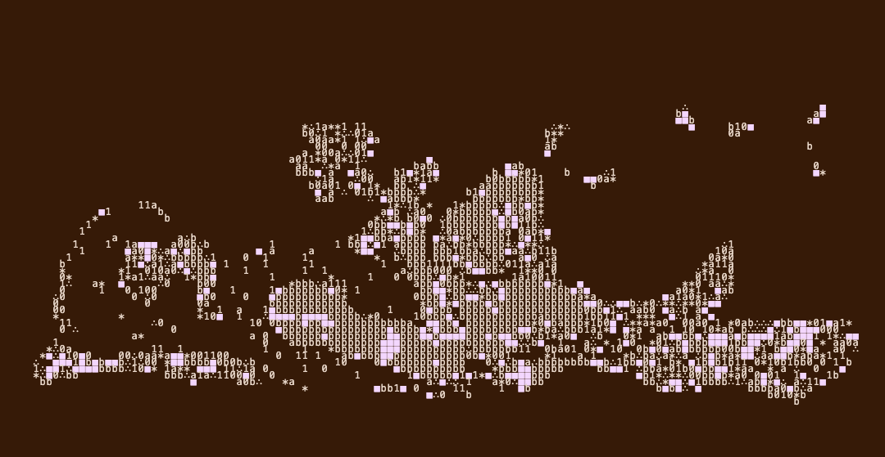

```python
riddhi = {
    "languages": ["Java", "Python", "Go", "HTML/CSS", "JavaScript", "TypeScript", "SQL"],
    "offline":   ["hiking", "running", "baking"],
    "reading":   ["What I Talk About When I Talk About Running by Haruki Murakami", "Stoner by John Williams"]
    "leading":   "six data-driven journalism projects for the Justice Media co-Lab course @ BU Spark!",
    "goal":      "to build beautiful tech",
}
```
<div align="center">
  
    <p> my remake of the wnyc transmitter park mural by faile in ascii <p>
</div>

<picture>
  <source media="(prefers-color-scheme: dark)" srcset="https://raw.githubusercontent.com/riddhikasralikar/riddhikasralikar/output/snake-dark.svg" />
  
</picture>

<!--
**riddhikasralikar/riddhikasralikar** is a ✨ _special_ ✨ repository because its `README.md` (this file) appears on your GitHub profile.

Here are some ideas to get you started:

- 🔭 I’m currently working on ...
- 🌱 I’m currently learning ...
- 👯 I’m looking to collaborate on ...
- 🤔 I’m looking for help with ...
- 💬 Ask me about ...
- 📫 How to reach me: ...
- 😄 Pronouns: ...
- ⚡ Fun fact: ...
-->
